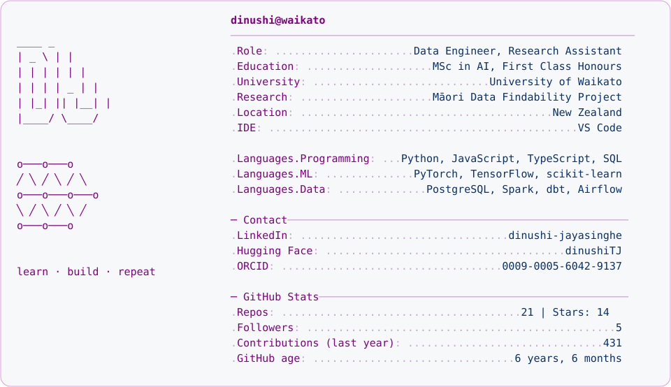

  <a href="https://linkedin.com/in/dinushi-jayasinghe" target="blank" title="LinkedIn"> <b>LinkedIn</b></a>
  &nbsp;·&nbsp;
  <a href="https://huggingface.co/dinushiTJ" target="blank" title="Hugging Face"> <b>Hugging Face</b></a>
  &nbsp;·&nbsp;
  <a href="https://orcid.org/0009-0005-6042-9137" target="blank" title="ORCID"> <b>ORCID</b></a>

  

<a href="https://github.com/dinushiTJ">
  <picture>
    <source media="(prefers-color-scheme: dark)" srcset="https://raw.githubusercontent.com/dinushiTJ/dinushiTJ/output/profile-card-dark.svg">
    
  </picture>
</a>

<!--
# Hi, I'm Dinushi 👋🏽

</img>
-->

  <picture>
    <source media="(prefers-color-scheme: dark)" srcset="https://raw.githubusercontent.com/dinushiTJ/dinushiTJ/output/github-contribution-grid-snake-dark.svg">
    <source media="(prefers-color-scheme: light)" srcset="https://raw.githubusercontent.com/dinushiTJ/dinushiTJ/output/github-contribution-grid-snake.svg">
    
  </picture>

## 👩🏽‍💻 About Me

Data Engineer and AI graduate based in New Zealand, with experience in data migration, ETL pipelines, data quality, analytics and applied AI. MSc in Artificial Intelligence with First Class Honours from the University of Waikato, with a background in Data Science.

Interested in building reliable, traceable and scalable data systems using Python, SQL and modern data engineering tools.

As a **Research Assistant** on the **Māori Data Findability Project**, I use LLM labelling and fine-tuned classifiers to find Māori data in NZ Parliament debates and the University of Waikato Research Commons.

  

## 🔬 Research

**[Māori Data Findability: Research Commons](https://github.com/dinushiTJ/maori-data-stage2-research-commons)**: 16.6k university research records labelled with Gemini, TF-IDF, EmbeddingGemma and Gemma-3-4B LoRA classifiers, with cross-provider label checks and full-text evidence extraction.

**[Māori Data Findability: Hansard](https://github.com/dinushiTJ/maori-data-stage1-hansard)**: The first stage, scraping NZ Parliament debates, labelling sections with Gemini, and fine-tuning an EmbeddingGemma classifier.

**[Aerial Image Classification](https://github.com/dinushiTJ/aerial-image-classification)**: Diffusion-generated synthetic data with Stable Diffusion 2.1 + LoRA, FID/CMMD quality scoring and 360 tracked training runs. [Datasets on Hugging Face](https://huggingface.co/collections/dinushiTJ/synthetic-data-augmented-aerial-datasets)

## 🏗️ Data Engineering

**[Smart Grocery Data Platform](https://github.com/dinushiTJ/smart-grocery-data-platform)**: A local lakehouse with bronze, silver and gold layers in PostgreSQL, a Spark + Delta streaming path, and Airflow, dbt and Great Expectations. [Live overview](https://dinushitj.github.io/smart-grocery-data-platform/)

**[HR Migration Sandbox](https://github.com/dinushiTJ/hr-migration-sandbox)**: Legacy HR and payroll data migrated into a Workday-shaped target, reconciled to the cent, with every change traced to a numbered rule. [Interactive replay](https://dinushitj.github.io/hr-migration-sandbox/)

**[Aircraft Tracking Data Warehouse](https://github.com/dinushiTJ/Aircraft-Tracking-Data-Warehouse)**: A SQL Server BI solution with SSIS ETL from 4 sources into a snowflake-schema warehouse with SCD2, plus an SSAS cube and SSRS reports.

<b>More projects</b>

 

**[Enhanced PDF Merger](https://github.com/dinushiTJ/Enhanced-PDF-Merger)**: Merge PDFs in the browser with an auto-generated, clickable table of contents. [Try it](https://dinushitj.github.io/Enhanced-PDF-Merger/)

**[SVG Combiner](https://github.com/dinushiTJ/SVG-Combiner)**: Combine two SVGs side by side for before/after comparisons. [Try it](https://dinushitj.github.io/SVG-Combiner/)

**[Bird Migration Visualization](https://github.com/dinushiTJ/bird-migration-vis)**: An interactive map of bird migration routes. [Try it](https://dinushitj.github.io/bird-migration-vis/)

**[Learn Something Today](https://github.com/dinushiTJ/learn-something-today)**: An interactive learning platform built around fun visual experiences. [Try it](https://dinushitj.github.io/learn-something-today/)

**[Birthday Energy Graph](https://github.com/dinushiTJ/insta-birthday-energy-graph)**: Type your birthday, get a wavy energy graph. 100% for fun, 0% science. [Try it](https://dinushitj.github.io/insta-birthday-energy-graph/)

## 🛠️ Skills & Tooling

**Languages & Core**

<table>
  <tr>
    <td align="center" width="90"> Python</td>
    <td align="center" width="90"> R</td>
    <td align="center" width="90"> Bash</td>
    <td align="center" width="90"> Linux</td>
    <td align="center" width="90"> Git</td>
    <td align="center" width="90"> Conda</td>
    <td align="center" width="90"> Jupyter</td>
    <td align="center" width="90"> VS Code</td>
    <td align="center" width="90"> PyCharm</td>
  </tr>
</table>

**Machine Learning & Data**

<table>
  <tr>
    <td align="center" width="90"> TensorFlow</td>
    <td align="center" width="90"> PyTorch</td>
    <td align="center" width="90"> scikit-learn</td>
    <td align="center" width="90"> NumPy</td>
    <td align="center" width="90"> Pandas</td>
    <td align="center" width="90"> Matplotlib</td>
    <td align="center" width="90"> Plotly</td>
  </tr>
</table>

**Data Engineering & Cloud**

<table>
  <tr>
    <td align="center" width="90"> Airflow</td>
    <td align="center" width="90"> dbt</td>
    <td align="center" width="90"> PostgreSQL</td>
    <td align="center" width="90"> MySQL</td>
    <td align="center" width="90"> SQL Server</td>
    <td align="center" width="90"> Oracle</td>
    <td align="center" width="90"> AWS</td>
    <td align="center" width="90"> Grafana</td>
  </tr>
</table>

Also: SSIS · SSRS · Jasper Reports

**Web & Design**

<table>
  <tr>
    <td align="center" width="90"> JavaScript</td>
    <td align="center" width="90"> TypeScript</td>
    <td align="center" width="90"> Figma</td>
  </tr>
</table>

**Areas of expertise**

Machine Learning · Deep Learning · NLP · Large Language Models · CNNs · Prompt Engineering · Statistical Data Analysis · SQL · ETL · Data Pipelines · Data Lakes · Data Warehousing & BI · Dashboards · Process Automation · UI/UX

<!--

-->

